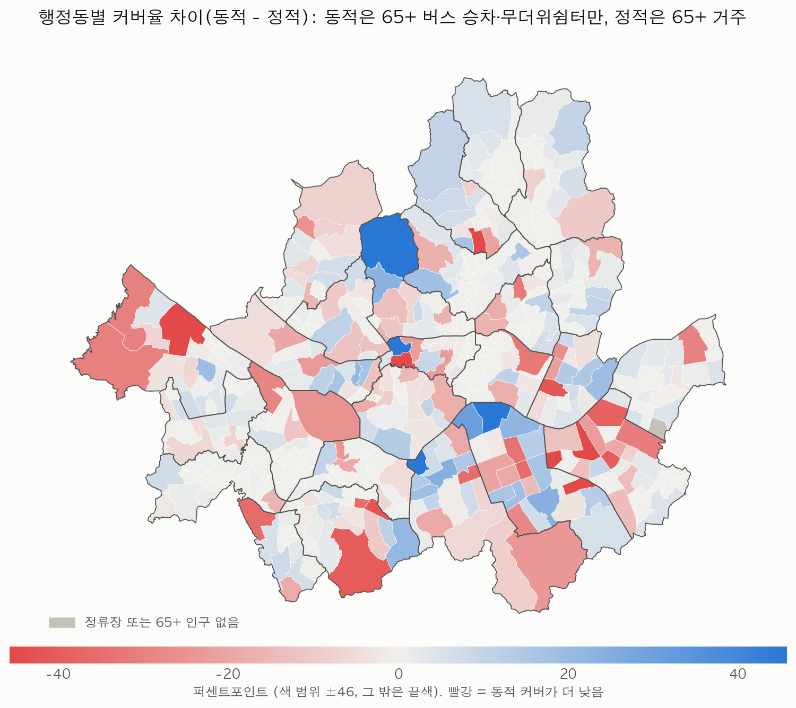
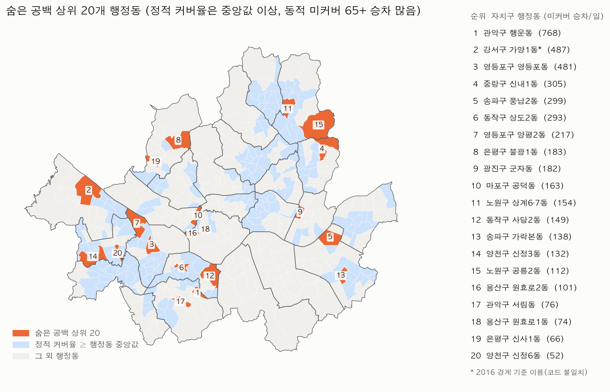

# RQ2 정적 기준 vs 동적 기준 무더위쉼터 커버리지 (미팅용 1차)

작성 2026-11-10. 표기: **[확인됨]** 파일을 직접 계산해 확인 · **[추정]** 근거는 있으나 직접 검증하지 않음 · **[미확인]** 확인하지 못함. 노출(ΔT)은 결합하지 않았다.

## 미팅용 요약

1. 서울 전체 300m 커버율은 정적(65+ 거주) 92.2%, 동적(65+ 버스 승차, 무더위쉼터만) 88.0%, 동적(스마트쉼터 포함) 88.5%이다 [추정: 동적은 추정 수요 기반].
2. 자치구 순위는 대체로 같다(스피어만 무더위쉼터만 0.88, 행정동 0.72) [확인됨: 계산]. 정적보다 동적(무더위쉼터만)이 가장 낮은 곳은 중구 -23.0, 송파구 -15.7, 영등포구 -11.3퍼센트포인트다 [추정].
3. 숨은 공백(정적 커버율 행정동 중앙값 97.3% 이상) 상위 20개 행정동의 동적 미커버 65+ 승차는 하루 4,431건으로 전체 미커버의 8.4%이며, 정적 중앙값 이상 행정동 전체로도 9.3%다 [추정]. 미커버의 대부분은 정적으로도 커버가 낮은 행정동에 있다 [추정].
4. 세 번째 기준인 D5 집계구 생활인구 데이터 내국인 65+ 11~17시 커버율은 84.3%(마스킹 상한 84.8%)로, 거주 기준(92.2%)과 동적(무더위쉼터만, 88.0%)보다 모두 낮다 [추정]. 자치구 순위 상관은 거주 기준과 0.87, 동적(무더위쉼터만)과 0.92다 [확인됨: 계산].
5. 정적은 집계구 중심점·2024년 거주 인구, 동적은 정류장 점·2025년 추정 승차라 단위와 시점이 달라, 차이는 지리 패턴으로 읽어야 한다 [확인됨: 구성].

## 데이터

### D6 SGIS 집계구 인구 데이터

- 위치: `googledrive:sdot-analysis/data1/D6_SGIS_stats/`(로컬 `data/raw/D6_SGIS_stats/`와 체크섬 차이 0) [확인됨]. 기준 연도는 **2024**이며 2025 자료는 없어 2024를 썼다 [확인됨].
- 파일: `11_2024년_성연령별인구.csv`, 헤더 없음(연도, 집계구코드, 항목코드, 값). 항목코드 63개: `in_age_001~021`, `031~051`, `061~081` [확인됨].
- 65세 이상 열: `in_age_014`~`in_age_021` 합. 코드표를 확보하지 못해 [미확인]이고, 001~021을 전체 연령으로 보고 데이터로 검증했다 [추정].

| 시작구간 | 가정나이 | 합계 | 노년부양비_상관 | 노년부양비_절대차_중앙값 | 노령화지수_상관 | 노령화지수_절대차_중앙값 |
|---|---|---|---|---|---|---|
| in_age_013 | 60세 이상 | 2,434,082 | 0.862 | 14.335 | 0.988 | 62.450 |
| in_age_014 | 65세 이상 | 1,728,079 | 0.975 | 0.848 | 0.998 | 5.511 |
| in_age_015 | 70세 이상 | 1,094,055 | 0.926 | 11.852 | 0.977 | 66.147 |

(모두 [확인됨: 계산]. 같은 파일의 노년부양비·노령화지수와 대조, 총인구 200명 이상 집계구. 014에서 시작할 때 상관이 가장 높고 절대차가 가장 작다.)

- 001~021 합은 총인구(`to_in_001`) 9,335,444명의 99.0%다 [확인됨]. 값이 5 미만인 칸은 행 자체가 없어(최솟값 5) 그만큼 빠진다 [확인됨]. 연령 자료가 없는 220개 집계구는 총인구도 0이다 [확인됨].
- 65세 이상 합은 1,728,079명이다(없는 구간 0). 없는 구간을 4로 둔 상한은 1,876,376명이고 커버율은 92.0%다 [확인됨: 계산].

#### D9 집계구 경계 일치율

| 경계 | 경계_집계구 | D6_총인구파일_집계구 | 일치 | 일치율 | D6_연령자료_집계구 | 연령자료_일치율 | 인구65_가중_일치율 |
|---|---|---|---|---|---|---|---|
| D9 집계구 경계 2025 2Q (TOT_OA_CD, 14자리) | 19,097 | 19,097 | 19,097 | 100.0% | 18,877 | 100.0% | 100.0% |
| D9 집계구 경계 2024 2Q (TOT_REG_CD, 14자리) | 19,218 | 19,097 | 17,802 | 93.2% | 18,877 | 93.3% | 94.4% |
| D9 집계구 경계 2016 (TOT_REG_CD, 13자리) | 19,153 | 19,097 | 0 | 0.0% | 18,877 | 0.0% | 0.0% |

(모두 [확인됨]) 100% 일치하는 D9 집계구 경계 2025 2Q(`TOT_OA_CD`)를 썼다.

### 쉼터와 동적 수요

- D7 무더위쉼터 목록 데이터(20250916): 4,049곳, 좌표 사용, 전부 서울 경계 안 [확인됨]. D14 스마트쉼터 데이터: est_v3의 연결표를 그대로 써 정류장 138개(199행 중 ID 연결 141행, 공사중 2행 제외) [확인됨].
- 동적: est_v3 2025-07·08 11~17시(시 라벨 7개) 65+ 승차(중간) 하루 평균, 정류장 11,240개, D21 서울시 버스정류소 위치정보 2025-08-01판 [확인됨].
- 재현 점검: 동적 합계 458,016, 무더위쉼터 커버율 88.0%, 스마트쉼터 포함 88.5%, 미커버 정류장 1,512개로 est_v3와 같다 [확인됨].
- **스마트쉼터는 정류장 시설이라 정적 기준에서는 제외**했다. 동적(스마트쉼터 포함)과 정적은 시설 범위가 다르므로, 같은 조건 비교에는 동적(무더위쉼터만)을 봐야 한다 [확인됨: 구성].

## 서울 전체 비교

| 기준 | 단위 | 총량 | 커버량 | 커버율 | 미커버량 | 대상 수(집계구·정류장) | 커버 대상 수 |
|---|---|---|---|---|---|---|---|
| 정적: D6 SGIS 집계구 인구 데이터 65+ 거주(무더위쉼터 300m) | 명 | 1,728,079 | 1,592,754 | 92.2% | 135,325 | 19,097 | 17,348 |
| 동적: 65+ 버스 승차(무더위쉼터만) | 명/일 승차 | 458,016 | 402,835 | 88.0% | 55,181 | 11,240 | 9,701 |
| 동적: 65+ 버스 승차(스마트쉼터 포함, est_v3 정의) | 명/일 승차 | 458,016 | 405,469 | 88.5% | 52,546 | 11,240 | 9,728 |

(정적 집합 [확인됨], 정적 65+ 구간 [추정], 동적 [추정])

## 자치구 비교

| 자치구 | 정적 | 동적(무더위쉼터만) | 동적(스마트쉼터 포함) | 차이(무더위쉼터만, pp) | 차이(스마트쉼터 포함, pp) | 순위 정적 | 순위 동적(무더위쉼터만) | 순위 동적(스마트쉼터 포함) |
|---|---|---|---|---|---|---|---|---|
| 중구 | 91.4% | 68.4% | 73.4% | -23.0 | -18.0 | 17 | 24 | 24 |
| 송파구 | 94.0% | 78.3% | 78.3% | -15.7 | -15.7 | 15 | 21 | 22 |
| 영등포구 | 95.1% | 83.9% | 83.9% | -11.3 | -11.3 | 13 | 19 | 19 |
| 마포구 | 83.9% | 76.1% | 79.6% | -7.7 | -4.3 | 22 | 23 | 21 |
| 동대문구 | 94.1% | 87.7% | 87.7% | -6.4 | -6.4 | 14 | 17 | 18 |
| 관악구 | 95.3% | 90.4% | 90.4% | -4.9 | -4.9 | 12 | 13 | 13 |
| 동작구 | 97.9% | 94.1% | 94.2% | -3.8 | -3.7 | 6 | 9 | 9 |
| 은평구 | 95.6% | 92.1% | 92.1% | -3.5 | -3.5 | 11 | 11 | 11 |
| 용산구 | 84.5% | 81.5% | 83.6% | -3.1 | -0.9 | 21 | 20 | 20 |
| 광진구 | 89.2% | 86.4% | 89.1% | -2.9 | -0.1 | 20 | 18 | 15 |
| 서대문구 | 95.9% | 93.0% | 93.0% | -2.9 | -2.9 | 10 | 10 | 10 |
| 성동구 | 98.1% | 95.2% | 95.4% | -2.9 | -2.7 | 4 | 8 | 8 |
| 강서구 | 92.4% | 89.9% | 90.4% | -2.5 | -2.0 | 16 | 14 | 14 |
| 강북구 | 90.5% | 88.1% | 88.1% | -2.4 | -2.4 | 19 | 15 | 16 |
| 강동구 | 97.7% | 96.0% | 96.0% | -1.8 | -1.8 | 7 | 7 | 7 |
| 서초구 | 77.9% | 77.0% | 77.0% | -0.9 | -0.9 | 24 | 22 | 23 |
| 금천구 | 91.4% | 90.8% | 90.8% | -0.7 | -0.7 | 18 | 12 | 12 |
| 구로구 | 99.0% | 98.6% | 98.6% | -0.4 | -0.4 | 1 | 3 | 3 |
| 양천구 | 98.0% | 97.8% | 97.8% | -0.1 | -0.1 | 5 | 5 | 5 |
| 노원구 | 98.4% | 98.3% | 98.3% | -0.1 | -0.1 | 3 | 4 | 4 |
| 중랑구 | 96.6% | 97.1% | 97.1% | +0.5 | +0.5 | 9 | 6 | 6 |
| 도봉구 | 98.7% | 99.9% | 99.9% | +1.2 | +1.2 | 2 | 1 | 1 |
| 성북구 | 96.9% | 98.6% | 98.6% | +1.7 | +1.7 | 8 | 2 | 2 |
| 강남구 | 56.0% | 60.1% | 63.2% | +4.1 | +7.2 | 25 | 25 | 25 |
| 종로구 | 83.3% | 87.8% | 87.8% | +4.5 | +4.5 | 23 | 16 | 17 |

(차이 = 동적 − 정적, 낮은 순. 순위 1 = 커버율 가장 높음)

### 순위 상관

| 단위 | 비교 | N | 스피어만 | p값 |
|---|---|---|---|---|
| 자치구 | 정적 vs 동적(무더위쉼터만) | 25 | 0.876 | <0.001 |
| 자치구 | 정적 vs 동적(스마트쉼터 포함) | 25 | 0.869 | <0.001 |
| 행정동 | 정적 vs 동적(무더위쉼터만) | 425 | 0.716 | <0.001 |
| 행정동 | 정적 vs 동적(스마트쉼터 포함) | 425 | 0.708 | <0.001 |

(모두 [확인됨: 계산])

- 강남구(56.0% / 60.1%)와 서초구(77.9% / 77.0%)는 두 기준 모두 낮다 [추정]. 중구·송파구·영등포구는 정적은 높지만 동적이 낮다 [추정].

## 숨은 공백 상위 20개 행정동

기준: 행정동 정적 커버율이 **행정동 간 중앙값 97.3%** 이상인 213개 동 중, 동적 미커버(스마트쉼터 포함 기준) 65+ 승차가 많은 순 [확인됨: 구성].

| 순위 | 자치구 | 행정동 | 코드 | 정적 | 동적(무더위쉼터만) | 동적(스마트쉼터 포함) | 미커버 65+ 승차(하루) | 미커버 정류장 | 가장 큰 미커버 정류장(몫) |
|---|---|---|---|---|---|---|---|---|---|
| 1 | 관악구 | 행운동 | 11210570 | 99.5% | 57.1% | 57.1% | 768 | 3 | 봉천사거리.봉천중앙시장 (72%) |
| 2 | 강서구 | 가양1동* | 11160751 | 98.5% | 45.7% | 45.7% | 487 | 25 | 발산역2번출구 (24%) |
| 3 | 영등포구 | 영등포동 | 11190740 | 98.7% | 87.3% | 87.3% | 481 | 5 | 영등포로터리 (41%) |
| 4 | 중랑구 | 신내1동 | 11070690 | 99.0% | 82.8% | 82.8% | 305 | 13 | 신내교회.신내데시앙아파트 (54%) |
| 5 | 송파구 | 풍납2동 | 11240520 | 98.4% | 59.5% | 59.5% | 299 | 4 | 서울아산병원동관 (37%) |
| 6 | 동작구 | 상도2동 | 11200540 | 100.0% | 80.4% | 80.4% | 293 | 3 | 동작구청.장승배기역2번출구 (70%) |
| 7 | 영등포구 | 양평2동 | 11190620 | 97.8% | 68.7% | 68.7% | 217 | 2 | 안양천입구 (51%) |
| 8 | 은평구 | 불광1동 | 11120520 | 98.2% | 93.5% | 93.5% | 183 | 2 | 연신내역 (94%) |
| 9 | 광진구 | 군자동 | 11050540 | 97.9% | 75.5% | 75.5% | 182 | 3 | 군자교입구 (51%) |
| 10 | 마포구 | 공덕동 | 11140770 | 99.4% | 86.8% | 86.8% | 163 | 3 | 마포경찰서 (72%) |
| 11 | 노원구 | 상계6·7동 | 11110770 | 100.0% | 91.5% | 91.5% | 154 | 1 | 상계주공2단지 (100%) |
| 12 | 동작구 | 사당2동 | 11200730 | 98.5% | 93.2% | 93.2% | 149 | 3 | 동작역.국립현충원 (53%) |
| 13 | 송파구 | 가락본동 | 11240650 | 100.0% | 86.2% | 86.2% | 138 | 2 | 가락시장역5번출구 (69%) |
| 14 | 양천구 | 신정3동 | 11150660 | 100.0% | 93.0% | 93.0% | 132 | 3 | 양천공영차고지 (74%) |
| 15 | 노원구 | 공릉2동 | 11110560 | 99.1% | 89.1% | 89.1% | 112 | 18 | 붕어방 (40%) |
| 16 | 용산구 | 원효로2동 | 11030570 | 100.0% | 81.2% | 81.2% | 101 | 3 | 원효로풍전아파트 (43%) |
| 17 | 관악구 | 서림동 | 11210660 | 98.7% | 94.0% | 94.0% | 76 | 2 | 신림중.삼성고.관악아트홀·도서관 (79%) |
| 18 | 용산구 | 원효로1동 | 11030720 | 100.0% | 90.1% | 90.1% | 74 | 5 | 원효로2가사거리 (28%) |
| 19 | 은평구 | 신사1동 | 11120650 | 100.0% | 94.1% | 94.1% | 66 | 1 | 응암역.신사오거리 (100%) |
| 20 | 양천구 | 신정6동 | 11150690 | 98.5% | 90.8% | 90.8% | 52 | 1 | 양천구청역 (100%) |

(동적 [추정]. * = 행정동 코드 앞 7자리가 2016 경계 코드와 달라, 겹침이 가장 큰 2016 행정동 이름을 임시로 붙임 [추정].)

- 숨은 공백은 정류장 몇 개에 몰린다. 상위 20개 중 최대 미커버 정류장 몫의 중앙값은 62%다 [확인됨: 계산].
- 정적 중앙값 이상 행정동의 미커버 합은 하루 4,861건으로 전체 미커버 52,546건의 9.3%이다 [추정].

## 지도

- 차이 지도는 같은 시설 조건인 동적(무더위쉼터만) − 정적이다. 전체 행정동별 값은 `table_dong_all.csv`에 있다. 그림은 dataviz 기본 팔레트를 썼고, node가 없어 팔레트 검증 스크립트는 돌리지 못했다 [미확인: 재검증].
- 차이가 크게 나온 동 일부는 정류장 수나 집계구 구조의 영향이다. 예: 반포본동 정적 0.0%, 동적 98.3%(정류장 3개, 큰 아파트 단지 집계구 중심점이 300m 밖으로 보임) [확인됨: 값 / 추정: 원인].

## 세 번째 기준: D5 집계구 생활인구 데이터

- 내국인, 65+ 열 4개 합, 11~17시(시 라벨 7개), 2025-07·08 62일 평균. 값은 시점 평균 체류 인구(명)다 [확인됨]. 집계구 19,153개 중 D9 집계구 경계 2016과 일치 19,153개 [확인됨]. 11~17시 65+ 열 하나라도 마스킹인 칸 47.9% [확인됨].

| 기준 | 총량 | 커버량 | 커버율 | 미커버량 |
|---|---|---|---|---|
| D5 집계구 생활인구 데이터 내국인 65+ 11~17시 (마스킹 하한 0) | 1,444,157 | 1,217,502 | 84.3% | 226,655 |
| D5 집계구 생활인구 데이터 내국인 65+ 11~17시 (마스킹 상한 4) | 1,540,614 | 1,306,330 | 84.8% | 234,284 |

| 단위 | 비교 | N | 스피어만 | p값 |
|---|---|---|---|---|
| 자치구 | D5 생활인구(하한) vs 정적 | 25 | 0.872 | <0.001 |
| 자치구 | D5 생활인구(하한) vs 동적(무더위쉼터만) | 25 | 0.920 | <0.001 |
| 자치구 | 정적 vs 동적(무더위쉼터만) | 25 | 0.876 | <0.001 |
| 행정동 | D5 생활인구(하한) vs 정적 | 425 | 0.808 | <0.001 |
| 행정동 | D5 생활인구(하한) vs 동적(무더위쉼터만) | 426 | 0.728 | <0.001 |
| 행정동 | 정적 vs 동적(무더위쉼터만) | 425 | 0.716 | <0.001 |

(모두 [확인됨: 계산])

| 자치구 | 정적 | D5 생활인구(하한) | D5 생활인구(상한) | 동적(무더위쉼터만) | 동적 - D5 하한(pp) |
|---|---|---|---|---|---|
| 중구 | 91.4% | 72.1% | 72.5% | 68.4% | -3.7 |
| 송파구 | 94.0% | 81.6% | 82.3% | 78.3% | -3.3 |
| 강북구 | 90.5% | 89.0% | 89.0% | 88.1% | -0.9 |
| 동작구 | 97.9% | 94.9% | 95.1% | 94.1% | -0.9 |
| 관악구 | 95.3% | 90.3% | 90.7% | 90.4% | +0.0 |
| 마포구 | 83.9% | 76.0% | 76.0% | 76.1% | +0.2 |
| 영등포구 | 95.1% | 83.3% | 83.8% | 83.9% | +0.6 |
| 동대문구 | 94.1% | 85.8% | 86.4% | 87.7% | +1.9 |
| 양천구 | 98.0% | 95.7% | 96.0% | 97.8% | +2.1 |
| 종로구 | 83.3% | 84.8% | 84.9% | 87.8% | +3.0 |
| 중랑구 | 96.6% | 93.9% | 94.1% | 97.1% | +3.3 |
| 성동구 | 98.1% | 91.8% | 92.2% | 95.2% | +3.5 |
| 강동구 | 97.7% | 92.5% | 92.7% | 96.0% | +3.5 |
| 구로구 | 99.0% | 94.8% | 95.2% | 98.6% | +3.7 |
| 노원구 | 98.4% | 94.4% | 94.7% | 98.3% | +4.0 |
| 성북구 | 96.9% | 94.4% | 94.7% | 98.6% | +4.2 |
| 도봉구 | 98.7% | 95.5% | 95.8% | 99.9% | +4.3 |
| 은평구 | 95.6% | 87.3% | 88.0% | 92.1% | +4.8 |
| 강서구 | 92.4% | 85.1% | 85.8% | 89.9% | +4.9 |
| 강남구 | 56.0% | 54.7% | 54.8% | 60.1% | +5.4 |
| 서초구 | 77.9% | 70.4% | 70.8% | 77.0% | +6.6 |
| 금천구 | 91.4% | 83.5% | 84.1% | 90.8% | +7.2 |
| 광진구 | 89.2% | 78.2% | 79.0% | 86.4% | +8.2 |
| 서대문구 | 95.9% | 84.2% | 85.1% | 93.0% | +8.8 |
| 용산구 | 84.5% | 66.4% | 67.4% | 81.5% | +15.0 |

## 한계

- 정적은 2024년 거주 인구, 쉼터는 2025-09-16 목록, 동적은 2025-07·08 승차로 시점이 다르다 [확인됨].
- 정적과 동적의 단위가 다르다. 정적은 사람 수, 동적은 승차 건수이고 버스 이용만 본다 [확인됨: 구성]. 커버율끼리만 비교할 수 있다 [추정].
- 공간 단위가 다르다. 정적은 집계구 중심점이 300m 안이면 집계구 인구 전체를 커버로 본다. 집계구가 큰 곳은 오차가 크다 [추정].
- 동적은 승차 정류장 위치 기준이며 승객의 거주 동이 아니다 [확인됨: 구성]. 동적 수요는 est_v3 추정치로, 지하철 보정의 버스 타당성은 [미확인]이다.
- D6 SGIS 집계구 인구 데이터의 65세 이상 코드는 데이터 대조로 정했고 공식 코드표는 [미확인]이다. 5 미만 칸은 빠져 있다 [확인됨].
- D5 집계구 생활인구 데이터은 D9 집계구 경계 2016 집계구 중심점으로, 정적은 2025 2Q 집계구 중심점으로 계산해 경계 시점이 다르다 [확인됨: 구성]. 11~17시 65+ 열 하나 이상 마스킹 칸이 47.9%이며, 내국인만 포함한다 [확인됨].
- 직선거리 300m이고 쉼터 운영 시간·수용 인원은 반영하지 않았다 [확인됨: 구성].
- 행정동 이름표가 없어 2025 코드에 2016 경계의 겹침 최대 이름을 붙였다. 코드 불일치 9개 동은 이름이 다를 수 있다 [확인됨: 수 / 추정: 이름].

## 건너뛴 단계

- 없음. 선택 항목 5(D5 집계구 생활인구 데이터)까지 수행했다.

## 결정이 필요한 사항

1. **숨은 공백 기준:** 행정동 중앙값(97.3%)과 미커버 절대량으로 뽑았다. 커버율 차이 기준이나 정류장 단위로 바꿀지 정해 주십시오.
2. **비교 단위:** 정적을 집계구 중심점이 아니라 면적 가중이나 건물 단위로 바꿀지. 동적과 공간 단위를 맞추려면 필요하다.
3. **정적 기준 인구:** D6 SGIS 집계구 인구 데이터은 2024년이다. 2025년 자료를 추가로 받을지.
4. **D5 집계구 생활인구 데이터을 표준 비교에 넣을지:** 포함한다면 마스킹 하한·상한 중 어느 값을 주 결과로 쓸지.
5. **행정동 이름표:** 2025 코드 공식 대응표를 구할지. 현재는 2016 경계 기반 임시 이름이다.
